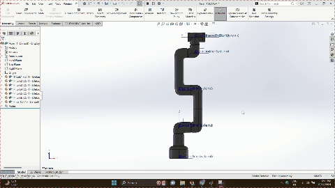
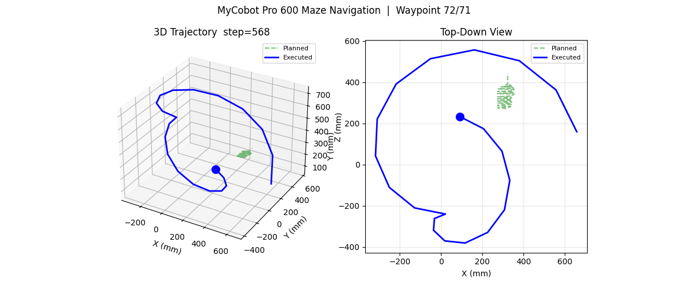

# MyCobot Pro 600 Maze Navigation — Python Simulation Replica

**Author**: Rhutvik

| Real Digital Twin (MATLAB/Simulink) | Python Simulation Replica |
|-------------------------------------|---------------------------|
| [](output/digital%20twin.mp4) | [](output/simulation.mp4) |
| *Click for full video (2 min, 129s)* | *Click for full video (generated with \`--record\`)* |

A pure-Python simulation replica of the MyCobot Pro 600 + Digital Twin maze navigation project.

## Original Project Reference
- **Inspired by**: Integration of MyCobot Pro 600 and Digital Twin for Maze Navigation
- **Domain**: Robotic Manipulation / Computer Vision
- **Original Stack**: Python (OpenCV), MATLAB (IK, Digital Twin), TCP Communication, Fusion 360 (URDF)

## This Replica
- **Author**: Rhutvik
- **Language**: Python 3.10+
- **Simulation**: Pure Python with NumPy/SciPy (no hardware required)
- **Visualization**: Matplotlib 3D animation
- **Architecture**: Mirrors the original 4-stage pipeline

## Architecture Overview

### Stage 1: Maze Solution (Computer Vision)
```
Camera Capture → ROI Selection → Grayscale → OTSU Threshold → 
Contour Detection → Morphological Path Extraction → 
Waypoint Extraction → Coordinate Normalization
```

### Stage 2: Coordinate Mapping
```
Maze Waypoints (normalized 0-1) → Linear Interpolation → 
Robot Workspace Coordinates (using 4 calibration corners)
```

### Stage 3: Digital Twin (Inverse Kinematics)
```
Robot Coordinates → URDF Import → IK Solver (SciPy optimize) → 
Joint Angles (degrees) → Joint Offset Adjustments → CSV Export
```

### Stage 4: Execution (Simulated TCP)
```
Joint Angles CSV → TCP Client → Simulated Robot Controller → 
Trajectory Visualization
```

## Real Digital Twin Demo

The `output/digital twin.mp4` in this repo is the **original MATLAB/Simulink digital twin simulation**:

- **Stage 1**: Maze capture → OpenCV processing → waypoint extraction
- **Stage 2**: Maze coords → Robot workspace coords (bilinear interpolation, 4 calibration corners)
- **Stage 3**: Robot coords → MATLAB IK (inverse kinematics) → joint angles with offsets
- **Stage 4**: Joint angles → TCP → MyCobot Pro 600 execution

| | |
|---|---|
| **Video** | [`output/digital twin.mp4`](output/digital%20twin.mp4) (141 MB, 129s, 2+ min) |
| **Preview** |  |
| **Pipeline** | Python (OpenCV) → MATLAB (IK) → TCP → Robot |

> **Note**: GitHub doesn't play large MP4 videos inline. The GIF above loops automatically — click it or the link above to download the full video.

## Quick Start

```bash
cd mycobot-maze-navigation
pip install -r requirements.txt
python src/main.py
```

## Project Structure
```
mycobot-maze-navigation/
├── README.md
├── requirements.txt
├── src/
│   ├── main.py                 # Entry point
│   ├── maze_solver.py          # Stage 1: OpenCV maze solving
│   ├── coordinate_mapper.py    # Stage 2: Maze → Robot coords
│   ├── ik_solver.py            # Stage 3: Inverse kinematics
│   ├── tcp_client.py           # Stage 4: Simulated TCP execution
│   ├── robot_model.py          # MyCobot Pro 600 kinematics
│   ├── visualize.py            # 3D visualization
│   └── config.py               # Configuration
├── assets/
│   ├── sample_maze.png         # Test maze image
│   └── mycobot_pro600.urdf     # Simplified URDF
└── output/
    ├── maze_solution.png
    ├── robot_trajectory.csv
    ├── joint_angles.csv
    ├── simulation.mp4
    ├── digital_twin_preview.gif      # Real digital twin preview (plays inline)
    └── simulation_preview.gif        # Python simulation preview (plays inline)
```

## Pipeline Outputs

Running the full pipeline generates:
1. `maze_solution.png` - Green path overlay on maze
2. `robot_trajectory.csv` - XYZ waypoints in robot coordinates
3. `joint_angles.csv` - Joint angles (degrees) for each waypoint
4. 3D animation of robot executing trajectory

## Adding Your Own Content

1. **Custom maze**: Replace `assets/sample_maze.png` with your maze photo
2. **Calibration**: Edit `src/config.py` with your 4 corner coordinates
3. **Video**: Run `python src/main.py --record` to generate `simulation.mp4`
4. **URDF**: Replace `assets/mycobot_pro600.urdf` with your robot model

## Configuration

Edit `src/config.py` for:
- Camera index and resolution
- Maze grid dimensions
- Robot workspace calibration corners
- IK solver parameters (weights, tolerances)
- TCP server IP/port (for real robot)

## License

MIT — based on academic project for educational use.